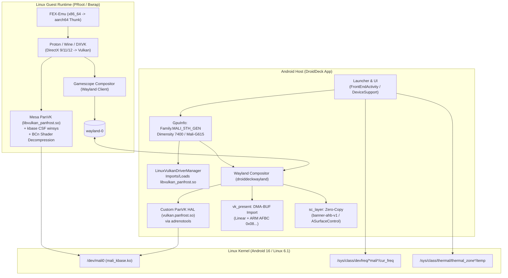

# Implementation Plan: Adding ARM Mali-G615 (MediaTek Dimensity 7400 Ultra) GPU Support to DroidDeck

**Working Branch:** `mali-g615` (in `DroidDeck/`)  
**Target Device:** Motorola Edge 2025 (Codename: *Oulu*)  
**Firmware Tag:** `MMI-W1VDS36H.50-38-10` (Android 16 / Linux 6.1)  
**Reference Source Trees:**
- `vendor-mediatek-kernel_modules-gpu/` (checked out at `MMI-W1VDS36H.50-38-10`: `mt6878/mali_avalon/mali-r44p1`)
- `motorola-kernel-modules/` (checked out at `android-16-release-w1vds36h.50-38-10` / `MMI-W1VDS36H.50-38-10`)
- `kernel-kernel_device_modules-6.1/` (checked out at `MMI-W1VDS36H.50-38-10`: `mt6878/`)
- `kernel-mtk/` (checked out at `MMI-W1VDS36H.50-38-10`)

## Goal Description
Enable hardware-accelerated Linux gaming on the **Motorola Edge 2025** featuring the **MediaTek Dimensity 7400 Ultra** (`MT6878V/TZA`) and **ARM Mali-G615 MC2** (Arm 5th Gen / Avalon / CSF architecture) running on **rootless stock Android 14/15/16**.

This plan transitions DroidDeck from an Adreno-exclusive architecture to a modular multi-vendor architecture, integrating the **Mesa PanVK** driver stack over Android's native `mali_kbase` character device (`/dev/mali0`), implementing ARM AFBC format modifier and AHardwareBuffer zero-copy presentation in the Wayland compositor, and wiring devfreq-based performance telemetry for MangoHUD.



---

## Architecture & Confirmed Decisions

1. **Target Environment:** Rootless stock Android (no root, no custom kernel flashing). Direct ioctl communication with `/dev/mali0` exposed by `mali_kbase.ko` (`mali-r44p1`).
2. **Driver Packaging & Delivery:** Hybrid model.
   - Bundle a baseline verified PanVK driver archive (`panvk-kbase` for Mali-G615).
   - Support manual importing of `.zip` driver bundles (`libvulkan_panfrost.so` + `meta.json` / `icd.json`) and automated updates via `AutoPicks`.
3. **Wayland Compositor Presentation:** Dual-path approach.
   - Primary: Custom PanVK Android HAL (`vulkan.panfrost.so`) loaded through `adrenotools`, with support for ARM AFBC format modifiers (`0x08...`).
   - Fallback: Zero-copy `AHardwareBuffer` presentation (`banner-ahb-v1` / `sc_layer.c` / `ASurfaceControl`).
4. **DirectX-to-Vulkan Compatibility:** Automatic Mali profile in `GameEnvironmentStore`.
   - Automatic activation of shader-based BCn decompression (`textureCompressionBC`).
   - ASTC fallback tuning.
   - PanVK memory allocation and debug presets (`PAN_MESA_DEBUG`).
   - User-controllable toggles exposed in game-specific settings.
5. **Telemetry & Power Management:**
   - Real-time clock and temperature feeds extracted from `/sys/class/devfreq/*mali*/` and `/sys/class/thermal/` into MangoHUD.
   - Safe clock governing: bypass Adreno KGSL ioctls (`IOCTL_KGSL_DRAWCTXT_DESTROY`, `KGSL_CMDBATCH_PWR_CONSTRAINT`) on Mali without causing crashes.

---

## Proposed Changes

### Phase 1: Hardware Classification & Gate Removal

#### [MODIFY] `app/src/main/java/com/droiddeck/launcher/gpu/GpuInfo.kt`
- Add `Family.MALI_5TH_GEN("Mali 5th Gen (CSF)")` and `Family.MALI("Mali")` to `GpuInfo.Family`.
- Detect `/dev/mali0` or `/vendor/lib64/hw/vulkan.mali.so`.
- In `modelFromNames()`, parse `Mali-G\d{3}` from `VulkanInfo.nativeQuery()`.
- Return `Support.TESTED` or `Support.UNTESTED` for `MALI_5TH_GEN` (Mali-G615).

```kotlin
enum class Family(val label: String) {
    A8XX("Adreno 8xx"),
    A7XX_LOW("Adreno 710/720/722"),
    A7XX("Adreno 7xx"),
    A6XX("Adreno 6xx"),
    MALI_5TH_GEN("Mali 5th Gen (CSF)"),
    MALI("Mali"),
    ADRENO_UNKNOWN("Adreno"),
    NOT_SUPPORTED("Unsupported GPU");
}
```

#### [MODIFY] `app/src/main/java/com/droiddeck/launcher/gpu/SocNames.kt`
- Add Dimensity 7400 definitions:
  - `"MT6878"` / `"MT6878V/TZA"` -> `"MediaTek Dimensity 7400 Ultra"`
  - `"mt6878"` -> `"Dimensity 7400 family"`

#### [MODIFY] `app/src/main/java/com/droiddeck/launcher/core/DeviceSupport.kt`
- Replace `adreno(): Boolean` check with multi-vendor support check:
```kotlin
fun supported(): Boolean =
    File("/sys/class/kgsl/kgsl-3d0").exists() ||
    File("/dev/mali0").exists() ||
    File("/vendor/lib64/hw/vulkan.adreno.so").exists() ||
    File("/vendor/lib64/hw/vulkan.mali.so").exists()
```

#### [MODIFY] `app/src/main/java/com/droiddeck/launcher/FrontEndActivity.kt`
- In `checkInstall()` and `startSession()`, replace `!DeviceSupport.adreno()` with `!DeviceSupport.supported()`, eliminating the blocking warning on Motorola Edge 2025.

---

### Phase 2: Linux Guest Device Node & Sandbox Binding

#### [MODIFY] `app/src/main/java/com/droiddeck/launcher/runtime/LinuxRuntime.java`
- In `bindGpuNode(Context context, List<String> cmd)`:
  - If `/dev/kgsl-3d0` is absent, check for `/dev/mali0`.
  - Bind `/dev/mali0` directly to `/dev/mali0` inside PRoot:
    `bind(cmd, "/dev/mali0:/dev/mali0");`
  - Stat `/dev/mali0` to register major/minor dev node in `/sys/dev/char/<major>:<minor>`.
- In `vulkanIcd(Context context)`:
  - On Mali, prioritize manifests matching `*panfrost*` or `*panvk*` over `freedreno`.

#### [MODIFY] `app/src/main/java/com/droiddeck/launcher/runtime/BwrapSpawner.kt`
- In `gpu(rootfs, root, env)`:
  - Allow `/dev/mali0` as a valid GPU device node.
  - Bind `libvulkan_panfrost.so` (and its dependencies) into `$GPU_DIR`.
  - Generate `panfrost_icd.json` pointing to `$GPU_DIR/libvulkan_panfrost.so`.
  - Set `VK_DRIVER_FILES` and `VK_ICD_FILENAMES` accordingly.

#### [MODIFY] `app/src/main/java/com/droiddeck/launcher/session/SessionService.kt`
- Check active driver: only pass `TU_DEBUG=sysmem` when using Turnip.
- Add PanVK environment variables (`PAN_MESA_DEBUG`).

---

### Phase 3: Driver Packaging & Auto-Picks

#### [MODIFY] `app/src/main/java/com/droiddeck/launcher/gpu/LinuxVulkanDriverManager.java`
- Generalize `LIB_NAME` checking:
  - Support both `libvulkan_freedreno.so` and `libvulkan_panfrost.so`.
  - Determine library name from `meta.json` or `icd.json` if packaged.
  - Allow `.zip` driver import to install PanVK drivers without raising `lvd_no_library`.

#### [MODIFY] `app/src/main/java/com/droiddeck/launcher/gpu/DriverBundle.kt`
- In `install()`, support extracting and linking `libvulkan_panfrost.so`.

#### [MODIFY] `app/src/main/java/com/droiddeck/launcher/gpu/DriverPairs.kt` & `AutoPicks.kt`
- Register `PANVK_G615 = "panvk-g615"`.
- Add auto-pick rule mapping `Family.MALI_5TH_GEN` to the PanVK driver pair.

---

### Phase 4: Wayland Compositor (ARM AFBC & Dual-Path Presentation)

#### [MODIFY] `app/src/main/cpp/waylandcomp/src/vk_present.h` & `src/vk_present.c`
- Define ARM DRM format modifiers:
  ```c
  #define DRM_FORMAT_MOD_ARM_AFBC_16x16 0x0800000000000001ULL
  ```
- In `vkp_dmabuf_modifiers()` and `modifier_importable()`:
  - Allow ARM AFBC modifiers (`vendor ID 0x08`).
- In `vkp_image_import_dmabuf()`:
  - Support importing AFBC modifiers.
  - Provide fallback to linear or AHB when modifier import is unavailable.

#### [MODIFY] `app/src/main/cpp/waylandcomp/src/wl_dmabuf.c`
- In `dmabuf_build_formats()`:
  - Advertise ARM AFBC format modifiers in `zwp_linux_dmabuf_v1`.

#### [MODIFY] `app/src/main/cpp/waylandcomp/src/gpu_clock_pin.c` & `GpuClockPin.kt`
- Guard `gpu_clock_pin.c`: check if `/dev/kgsl-3d0` exists before invoking KGSL ioctls; return early on Mali without error.
- In `GpuClockPin.kt`: report `gpu clock: governed (Mali devfreq)` when on Mali.

#### [MODIFY] `app/src/main/java/com/droiddeck/launcher/session/GpuStatsComponent.kt` & `LinuxRuntime.java`
- Scan `/sys/class/devfreq/` for nodes matching `mali` or `gpu`.
- Read `cur_freq` and thermal zone temperatures for MangoHUD feeds.

---

## Verification Plan

### Automated Tests
```bash
# Run launcher GPU and driver bundle unit tests
./gradlew -PskipRust=true :app:testDebugUnitTest --tests "com.droiddeck.launcher.gpu.*"

# Run preload, shader, and helper tests
bash tools/test_local.sh
```

### Manual Verification on Motorola Edge 2025
1. **Device Detection:**
   - Launch app -> navigate to **Settings -> Device Info**.
   - Verify SoC reports: `MediaTek Dimensity 7400 Ultra (MT6878)`.
   - Verify GPU reports: `Mali-G615`, Family: `Mali 5th Gen (CSF)`.
   - Verify support status: `Supported` (no blocking "Non-Adreno" dialog).
2. **Driver Installation:**
   - Import `panvk-kbase` driver zip via **Setup -> Linux Vulkan Driver**.
   - Verify successful installation and display in driver selection.
3. **Session Start & Device Node Verification:**
   - Launch Steam or Desktop session.
   - Confirm `/dev/mali0` is present inside container:
     `ls -la /dev/mali0`
   - Confirm `gamescope` launches and initializes Vulkan without exit code `73`.
4. **Compositor Presentation:**
   - Verify game window draws on screen through Wayland compositor.
   - Check logcat: confirm `vk_present` imported frames or `sc_layer` presented via AHB zero-copy.
5. **MangoHUD Telemetry:**
   - Toggle MangoHUD on in session drawer.
   - Verify GPU clock (MHz) and temperature (°C) update from devfreq feeds.
